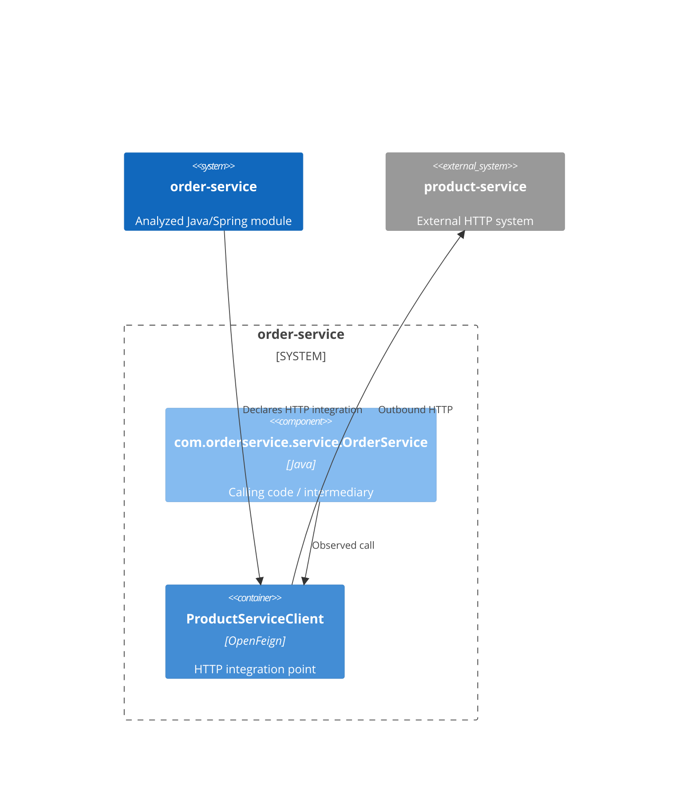

# Outbound HTTP dependencies: order-service

**Module:** order-service
**Module path:** /Users/edsnodgrass/Projects/build-a-software-factory/order-service

## Summary

Found 1 statically declared Feign outbound HTTP dependency.

An adapter is code that keeps the details of communicating with an external service separate from the module's own work. A domain-facing interface expresses what the calling code needs without exposing HTTP client details. The guidance below is a suggestion, not an observed fact or a required change.

## Finding 1: product-service

order-service makes an outbound HTTP connection to product-service through its ProductServiceClient Feign integration point.

- **External system:** product-service
- **Destination:** ${product-service.url} (destination unresolved)
- **Confidence:** Lower confidence. The client declaration is visible, but the destination contains an unresolved property placeholder. Its value was not guessed or resolved.
- **Client declaration evidence:** src/main/java/com/orderservice/client/ProductServiceClient.java:13

### HTTP operations (supporting detail)

- GET /products/{productId} (declared operation: getProduct). Evidence: src/main/java/com/orderservice/client/ProductServiceClient.java:16.

### How the code uses this connection

Source calls show possible behavior, not proof of execution. Observed usage describes source invocations only; destination confidence is separate from usage certainty.
The applied traversal limit is 2 call steps; the outbound HTTP connection and interface resolution do not count as steps.

- Chain 1 — Observed source chain: com.orderservice.service.OrderService → com.orderservice.client.ProductServiceClient. com.orderservice.service.OrderService calls the Feign integration point directly.

### Evidence and uncertainty

- Chain 1:
  - Observed call: Invocation in com.orderservice.service.OrderService.resolveItem at src/main/java/com/orderservice/service/OrderService.java:86; receiver productServiceClient declared as com.orderservice.client.ProductServiceClient at src/main/java/com/orderservice/service/OrderService.java:27; target method com.orderservice.client.ProductServiceClient.getProduct at src/main/java/com/orderservice/client/ProductServiceClient.java:16; method name at src/main/java/com/orderservice/client/ProductServiceClient.java:17.
Relevant unresolved connections follow; these do not establish additional routes to this Feign client:
- Unresolved connection (unsupported-receiver) in com.orderservice.service.OrderService.resolveItem at src/main/java/com/orderservice/service/OrderService.java:86: Receiver request is not an unshadowed explicitly typed field; local, parameter and other receiver forms are not followed.
- Unresolved connection (unsupported-receiver) in com.orderservice.service.OrderService.resolveItem at src/main/java/com/orderservice/service/OrderService.java:88: Receiver request is not an unshadowed explicitly typed field; local, parameter and other receiver forms are not followed.
- Unresolved connection (unsupported-receiver) in com.orderservice.service.OrderService.resolveItem at src/main/java/com/orderservice/service/OrderService.java:90: Receiver OrderItem is not an unshadowed explicitly typed field; local, parameter and other receiver forms are not followed.
- Unresolved connection (unsupported-receiver) in com.orderservice.service.OrderService.resolveItem at src/main/java/com/orderservice/service/OrderService.java:90: Receiver product is not an unshadowed explicitly typed field; local, parameter and other receiver forms are not followed.
- Unresolved connection (unsupported-receiver) in com.orderservice.service.OrderService.resolveItem at src/main/java/com/orderservice/service/OrderService.java:90: Receiver product is not an unshadowed explicitly typed field; local, parameter and other receiver forms are not followed.
- Unresolved connection (unsupported-receiver) in com.orderservice.service.OrderService.resolveItem at src/main/java/com/orderservice/service/OrderService.java:90: Receiver product is not an unshadowed explicitly typed field; local, parameter and other receiver forms are not followed.
- Unresolved connection (unsupported-receiver) in com.orderservice.service.OrderService.resolveItem at src/main/java/com/orderservice/service/OrderService.java:90: Receiver request is not an unshadowed explicitly typed field; local, parameter and other receiver forms are not followed.

### Where an adapter could fit

- **Suggestion:** Review whether com.orderservice.service.OrderService, which calls com.orderservice.client.ProductServiceClient directly, also handles business decisions. If so, a domain-facing interface between that calling code and the Feign integration could isolate external-service and HTTP details. The direct caller may itself serve as an adapter; direct use alone is not an architectural defect.

## Module-wide unresolved connections

These diagnostics are module context, not established routes to any reported Feign client.

- Unresolved connection (unsupported-receiver) in com.orderservice.OrderServiceApplication.main at src/main/java/com/orderservice/OrderServiceApplication.java:12: Receiver SpringApplication is not an unshadowed explicitly typed field; local, parameter and other receiver forms are not followed.
- Unresolved connection (unsupported-receiver) in com.orderservice.api.GlobalExceptionHandler.handleUnknownProduct at src/main/java/com/orderservice/api/GlobalExceptionHandler.java:22: Receiver ResponseEntity is not an unshadowed explicitly typed field; local, parameter and other receiver forms are not followed.
- Unresolved connection (unsupported-receiver) in com.orderservice.api.GlobalExceptionHandler.handleUnknownProduct at src/main/java/com/orderservice/api/GlobalExceptionHandler.java:22: Receiver &#60;chained expression&#62; is not an unshadowed explicitly typed field; local, parameter and other receiver forms are not followed.
- Unresolved connection (unsupported-receiver) in com.orderservice.api.GlobalExceptionHandler.handleUnknownProduct at src/main/java/com/orderservice/api/GlobalExceptionHandler.java:22: Receiver e is not an unshadowed explicitly typed field; local, parameter and other receiver forms are not followed.
- Unresolved connection (unsupported-receiver) in com.orderservice.api.GlobalExceptionHandler.handleValidation at src/main/java/com/orderservice/api/GlobalExceptionHandler.java:27: Receiver ResponseEntity is not an unshadowed explicitly typed field; local, parameter and other receiver forms are not followed.
- Unresolved connection (unsupported-receiver) in com.orderservice.api.GlobalExceptionHandler.handleValidation at src/main/java/com/orderservice/api/GlobalExceptionHandler.java:27: Receiver &#60;chained expression&#62; is not an unshadowed explicitly typed field; local, parameter and other receiver forms are not followed.
- Unresolved connection (unsupported-receiver) in com.orderservice.api.GlobalExceptionHandler.handleMissingHeader at src/main/java/com/orderservice/api/GlobalExceptionHandler.java:32: Receiver ResponseEntity is not an unshadowed explicitly typed field; local, parameter and other receiver forms are not followed.
- Unresolved connection (unsupported-receiver) in com.orderservice.api.GlobalExceptionHandler.handleMissingHeader at src/main/java/com/orderservice/api/GlobalExceptionHandler.java:32: Receiver &#60;chained expression&#62; is not an unshadowed explicitly typed field; local, parameter and other receiver forms are not followed.
- Unresolved connection (unsupported-receiver) in com.orderservice.api.GlobalExceptionHandler.handleMissingHeader at src/main/java/com/orderservice/api/GlobalExceptionHandler.java:32: Receiver e is not an unshadowed explicitly typed field; local, parameter and other receiver forms are not followed.
- Unresolved connection (unsupported-receiver) in com.orderservice.api.GlobalExceptionHandler.handleTypeMismatch at src/main/java/com/orderservice/api/GlobalExceptionHandler.java:37: Receiver ResponseEntity is not an unshadowed explicitly typed field; local, parameter and other receiver forms are not followed.
- Unresolved connection (unsupported-receiver) in com.orderservice.api.GlobalExceptionHandler.handleTypeMismatch at src/main/java/com/orderservice/api/GlobalExceptionHandler.java:37: Receiver &#60;chained expression&#62; is not an unshadowed explicitly typed field; local, parameter and other receiver forms are not followed.
- Unresolved connection (unsupported-receiver) in com.orderservice.api.GlobalExceptionHandler.handleNotFound at src/main/java/com/orderservice/api/GlobalExceptionHandler.java:42: Receiver ResponseEntity is not an unshadowed explicitly typed field; local, parameter and other receiver forms are not followed.
- Unresolved connection (unsupported-receiver) in com.orderservice.api.GlobalExceptionHandler.handleNotFound at src/main/java/com/orderservice/api/GlobalExceptionHandler.java:42: Receiver &#60;chained expression&#62; is not an unshadowed explicitly typed field; local, parameter and other receiver forms are not followed.
- Unresolved connection (unsupported-receiver) in com.orderservice.api.GlobalExceptionHandler.handleNotFound at src/main/java/com/orderservice/api/GlobalExceptionHandler.java:42: Receiver e is not an unshadowed explicitly typed field; local, parameter and other receiver forms are not followed.
- Unresolved connection (unsupported-receiver) in com.orderservice.api.GlobalExceptionHandler.handleInvalidTransition at src/main/java/com/orderservice/api/GlobalExceptionHandler.java:47: Receiver ResponseEntity is not an unshadowed explicitly typed field; local, parameter and other receiver forms are not followed.
- Unresolved connection (unsupported-receiver) in com.orderservice.api.GlobalExceptionHandler.handleInvalidTransition at src/main/java/com/orderservice/api/GlobalExceptionHandler.java:47: Receiver &#60;chained expression&#62; is not an unshadowed explicitly typed field; local, parameter and other receiver forms are not followed.
- Unresolved connection (unsupported-receiver) in com.orderservice.api.GlobalExceptionHandler.handleInvalidTransition at src/main/java/com/orderservice/api/GlobalExceptionHandler.java:47: Receiver e is not an unshadowed explicitly typed field; local, parameter and other receiver forms are not followed.
- Unresolved connection (unsupported-receiver) in com.orderservice.api.GlobalExceptionHandler.handleNotStaff at src/main/java/com/orderservice/api/GlobalExceptionHandler.java:52: Receiver ResponseEntity is not an unshadowed explicitly typed field; local, parameter and other receiver forms are not followed.
- Unresolved connection (unsupported-receiver) in com.orderservice.api.GlobalExceptionHandler.handleNotStaff at src/main/java/com/orderservice/api/GlobalExceptionHandler.java:52: Receiver &#60;chained expression&#62; is not an unshadowed explicitly typed field; local, parameter and other receiver forms are not followed.
- Unresolved connection (unsupported-receiver) in com.orderservice.api.OrderController.placeOrder at src/main/java/com/orderservice/api/OrderController.java:44: Receiver SecurityConfig is not an unshadowed explicitly typed field; local, parameter and other receiver forms are not followed.
- Unresolved connection (unsupported-receiver) in com.orderservice.api.OrderController.placeOrder at src/main/java/com/orderservice/api/OrderController.java:45: Receiver request is not an unshadowed explicitly typed field; local, parameter and other receiver forms are not followed.
- Unresolved connection (unsupported-receiver) in com.orderservice.api.OrderController.placeOrder at src/main/java/com/orderservice/api/OrderController.java:45: Receiver &#60;chained expression&#62; is not an unshadowed explicitly typed field; local, parameter and other receiver forms are not followed.
- Unresolved connection (unsupported-receiver) in com.orderservice.api.OrderController.placeOrder at src/main/java/com/orderservice/api/OrderController.java:46: Receiver &#60;chained expression&#62; is not an unshadowed explicitly typed field; local, parameter and other receiver forms are not followed.
- Unresolved connection (unsupported-receiver) in com.orderservice.api.OrderController.placeOrder at src/main/java/com/orderservice/api/OrderController.java:46: Receiver i is not an unshadowed explicitly typed field; local, parameter and other receiver forms are not followed.
- Unresolved connection (unsupported-receiver) in com.orderservice.api.OrderController.placeOrder at src/main/java/com/orderservice/api/OrderController.java:46: Receiver i is not an unshadowed explicitly typed field; local, parameter and other receiver forms are not followed.
- Unresolved connection (unsupported-receiver) in com.orderservice.api.OrderController.placeOrder at src/main/java/com/orderservice/api/OrderController.java:47: Receiver &#60;chained expression&#62; is not an unshadowed explicitly typed field; local, parameter and other receiver forms are not followed.
- Unresolved connection (unsupported-receiver) in com.orderservice.api.OrderController.placeOrder at src/main/java/com/orderservice/api/OrderController.java:50: Receiver MDC is not an unshadowed explicitly typed field; local, parameter and other receiver forms are not followed.
- Unresolved connection (unsupported-receiver) in com.orderservice.api.OrderController.placeOrder at src/main/java/com/orderservice/api/OrderController.java:50: Receiver result is not an unshadowed explicitly typed field; local, parameter and other receiver forms are not followed.
- Unresolved connection (unsupported-receiver) in com.orderservice.api.OrderController.placeOrder at src/main/java/com/orderservice/api/OrderController.java:50: Receiver &#60;chained expression&#62; is not an unshadowed explicitly typed field; local, parameter and other receiver forms are not followed.
- Unresolved connection (unsupported-receiver) in com.orderservice.api.OrderController.placeOrder at src/main/java/com/orderservice/api/OrderController.java:52: Receiver result is not an unshadowed explicitly typed field; local, parameter and other receiver forms are not followed.
- Unresolved connection (unsupported-receiver) in com.orderservice.api.OrderController.placeOrder at src/main/java/com/orderservice/api/OrderController.java:53: Receiver ResponseEntity is not an unshadowed explicitly typed field; local, parameter and other receiver forms are not followed.
- Unresolved connection (unsupported-receiver) in com.orderservice.api.OrderController.placeOrder at src/main/java/com/orderservice/api/OrderController.java:53: Receiver &#60;chained expression&#62; is not an unshadowed explicitly typed field; local, parameter and other receiver forms are not followed.
- Unresolved connection (unsupported-receiver) in com.orderservice.api.OrderController.placeOrder at src/main/java/com/orderservice/api/OrderController.java:53: Receiver result is not an unshadowed explicitly typed field; local, parameter and other receiver forms are not followed.
- Unresolved connection (unsupported-receiver) in com.orderservice.api.OrderController.getOrder at src/main/java/com/orderservice/api/OrderController.java:58: Receiver SecurityConfig is not an unshadowed explicitly typed field; local, parameter and other receiver forms are not followed.
- Unresolved connection (unsupported-receiver) in com.orderservice.api.OrderController.getOrder at src/main/java/com/orderservice/api/OrderController.java:60: Receiver &#60;chained expression&#62; is not an unshadowed explicitly typed field; local, parameter and other receiver forms are not followed.
- Unresolved connection (unsupported-receiver) in com.orderservice.api.OrderController.getOrder at src/main/java/com/orderservice/api/OrderController.java:61: Receiver ResponseEntity is not an unshadowed explicitly typed field; local, parameter and other receiver forms are not followed.
- Unresolved connection (unsupported-receiver) in com.orderservice.api.OrderController.advanceOrderStatus at src/main/java/com/orderservice/api/OrderController.java:68: Receiver SecurityConfig is not an unshadowed explicitly typed field; local, parameter and other receiver forms are not followed.
- Unresolved connection (unsupported-receiver) in com.orderservice.api.OrderController.advanceOrderStatus at src/main/java/com/orderservice/api/OrderController.java:69: Receiver request is not an unshadowed explicitly typed field; local, parameter and other receiver forms are not followed.
- Unresolved connection (unsupported-receiver) in com.orderservice.api.OrderController.advanceOrderStatus at src/main/java/com/orderservice/api/OrderController.java:70: Receiver ResponseEntity is not an unshadowed explicitly typed field; local, parameter and other receiver forms are not followed.
- Unresolved connection (unsupported-receiver) in com.orderservice.api.OrderController.toDetail at src/main/java/com/orderservice/api/OrderController.java:74: Receiver order is not an unshadowed explicitly typed field; local, parameter and other receiver forms are not followed.
- Unresolved connection (unsupported-receiver) in com.orderservice.api.OrderController.toDetail at src/main/java/com/orderservice/api/OrderController.java:74: Receiver &#60;chained expression&#62; is not an unshadowed explicitly typed field; local, parameter and other receiver forms are not followed.
- Unresolved connection (unsupported-receiver) in com.orderservice.api.OrderController.toDetail at src/main/java/com/orderservice/api/OrderController.java:75: Receiver &#60;chained expression&#62; is not an unshadowed explicitly typed field; local, parameter and other receiver forms are not followed.
- Unresolved connection (unsupported-receiver) in com.orderservice.api.OrderController.toDetail at src/main/java/com/orderservice/api/OrderController.java:76: Receiver item is not an unshadowed explicitly typed field; local, parameter and other receiver forms are not followed.
- Unresolved connection (unsupported-receiver) in com.orderservice.api.OrderController.toDetail at src/main/java/com/orderservice/api/OrderController.java:76: Receiver item is not an unshadowed explicitly typed field; local, parameter and other receiver forms are not followed.
- Unresolved connection (unsupported-receiver) in com.orderservice.api.OrderController.toDetail at src/main/java/com/orderservice/api/OrderController.java:76: Receiver item is not an unshadowed explicitly typed field; local, parameter and other receiver forms are not followed.
- Unresolved connection (unsupported-receiver) in com.orderservice.api.OrderController.toDetail at src/main/java/com/orderservice/api/OrderController.java:76: Receiver &#60;chained expression&#62; is not an unshadowed explicitly typed field; local, parameter and other receiver forms are not followed.
- Unresolved connection (unsupported-receiver) in com.orderservice.api.OrderController.toDetail at src/main/java/com/orderservice/api/OrderController.java:76: Receiver item is not an unshadowed explicitly typed field; local, parameter and other receiver forms are not followed.
- Unresolved connection (unsupported-receiver) in com.orderservice.api.OrderController.toDetail at src/main/java/com/orderservice/api/OrderController.java:77: Receiver &#60;chained expression&#62; is not an unshadowed explicitly typed field; local, parameter and other receiver forms are not followed.
- Unresolved connection (unsupported-receiver) in com.orderservice.api.OrderController.toDetail at src/main/java/com/orderservice/api/OrderController.java:78: Receiver order is not an unshadowed explicitly typed field; local, parameter and other receiver forms are not followed.
- Unresolved connection (unsupported-receiver) in com.orderservice.api.OrderController.toDetail at src/main/java/com/orderservice/api/OrderController.java:78: Receiver &#60;chained expression&#62; is not an unshadowed explicitly typed field; local, parameter and other receiver forms are not followed.
- Unresolved connection (unsupported-receiver) in com.orderservice.api.OrderController.toDetail at src/main/java/com/orderservice/api/OrderController.java:79: Receiver &#60;chained expression&#62; is not an unshadowed explicitly typed field; local, parameter and other receiver forms are not followed.
- Unresolved connection (unsupported-receiver) in com.orderservice.api.OrderController.toDetail at src/main/java/com/orderservice/api/OrderController.java:79: Receiver entry is not an unshadowed explicitly typed field; local, parameter and other receiver forms are not followed.
- Unresolved connection (unsupported-receiver) in com.orderservice.api.OrderController.toDetail at src/main/java/com/orderservice/api/OrderController.java:79: Receiver entry is not an unshadowed explicitly typed field; local, parameter and other receiver forms are not followed.
- Unresolved connection (unsupported-receiver) in com.orderservice.api.OrderController.toDetail at src/main/java/com/orderservice/api/OrderController.java:80: Receiver &#60;chained expression&#62; is not an unshadowed explicitly typed field; local, parameter and other receiver forms are not followed.
- Unresolved connection (unsupported-receiver) in com.orderservice.api.OrderController.toDetail at src/main/java/com/orderservice/api/OrderController.java:81: Receiver order is not an unshadowed explicitly typed field; local, parameter and other receiver forms are not followed.
- Unresolved connection (unsupported-receiver) in com.orderservice.api.OrderController.toDetail at src/main/java/com/orderservice/api/OrderController.java:81: Receiver order is not an unshadowed explicitly typed field; local, parameter and other receiver forms are not followed.
- Unresolved connection (unsupported-receiver) in com.orderservice.domain.Order.Order at src/main/java/com/orderservice/domain/Order.java:64: Receiver items is not an unshadowed explicitly typed field; local, parameter and other receiver forms are not followed.
- Unresolved connection (unsupported-receiver) in com.orderservice.domain.Order.Order at src/main/java/com/orderservice/domain/Order.java:72: Receiver this.items is not an unshadowed explicitly typed field; local, parameter and other receiver forms are not followed.
- Unresolved connection (unsupported-receiver) in com.orderservice.domain.Order.Order at src/main/java/com/orderservice/domain/Order.java:74: Receiver this.statusHistory is not an unshadowed explicitly typed field; local, parameter and other receiver forms are not followed.
- Unresolved connection (unsupported-receiver) in com.orderservice.domain.Order.Order at src/main/java/com/orderservice/domain/Order.java:74: Receiver OrderStatusHistoryEntry is not an unshadowed explicitly typed field; local, parameter and other receiver forms are not followed.
- Unresolved connection (unsupported-receiver) in com.orderservice.domain.Order.place at src/main/java/com/orderservice/domain/Order.java:79: Receiver UUID is not an unshadowed explicitly typed field; local, parameter and other receiver forms are not followed.
- Unresolved connection (unsupported-receiver) in com.orderservice.domain.Order.recordStatusReached at src/main/java/com/orderservice/domain/Order.java:89: Receiver this.statusHistory is not an unshadowed explicitly typed field; local, parameter and other receiver forms are not followed.
- Unresolved connection (unsupported-receiver) in com.orderservice.domain.Order.recordStatusReached at src/main/java/com/orderservice/domain/Order.java:89: Receiver OrderStatusHistoryEntry is not an unshadowed explicitly typed field; local, parameter and other receiver forms are not followed.
- Unresolved connection (unsupported-receiver) in com.orderservice.domain.Order.getItems at src/main/java/com/orderservice/domain/Order.java:117: Receiver Collections is not an unshadowed explicitly typed field; local, parameter and other receiver forms are not followed.
- Unresolved connection (unsupported-receiver) in com.orderservice.domain.Order.getStatusHistory at src/main/java/com/orderservice/domain/Order.java:121: Receiver Collections is not an unshadowed explicitly typed field; local, parameter and other receiver forms are not followed.
- Unresolved connection (unsupported-receiver) in com.orderservice.domain.OrderItem.of at src/main/java/com/orderservice/domain/OrderItem.java:46: Receiver UUID is not an unshadowed explicitly typed field; local, parameter and other receiver forms are not followed.
- Unresolved connection (unsupported-receiver) in com.orderservice.domain.OrderStatusHistoryEntry.reached at src/main/java/com/orderservice/domain/OrderStatusHistoryEntry.java:42: Receiver UUID is not an unshadowed explicitly typed field; local, parameter and other receiver forms are not followed.
- Unresolved connection (unsupported-receiver) in com.orderservice.event.KafkaProducerConfig.orderLifecycleEventsTopic at src/main/java/com/orderservice/event/KafkaProducerConfig.java:22: Receiver TopicBuilder is not an unshadowed explicitly typed field; local, parameter and other receiver forms are not followed.
- Unresolved connection (unsupported-receiver) in com.orderservice.event.KafkaProducerConfig.orderLifecycleEventsTopic at src/main/java/com/orderservice/event/KafkaProducerConfig.java:23: Receiver &#60;chained expression&#62; is not an unshadowed explicitly typed field; local, parameter and other receiver forms are not followed.
- Unresolved connection (unsupported-receiver) in com.orderservice.event.KafkaProducerConfig.orderLifecycleEventsTopic at src/main/java/com/orderservice/event/KafkaProducerConfig.java:24: Receiver &#60;chained expression&#62; is not an unshadowed explicitly typed field; local, parameter and other receiver forms are not followed.
- Unresolved connection (unsupported-receiver) in com.orderservice.event.KafkaProducerConfig.orderLifecycleEventsTopic at src/main/java/com/orderservice/event/KafkaProducerConfig.java:25: Receiver &#60;chained expression&#62; is not an unshadowed explicitly typed field; local, parameter and other receiver forms are not followed.
- Unresolved connection (unsupported-receiver) in com.orderservice.event.OrderLifecycleEventPublisher.publish at src/main/java/com/orderservice/event/OrderLifecycleEventPublisher.java:28: Receiver kafkaTemplate is not an unshadowed explicitly typed field; local, parameter and other receiver forms are not followed.
- Unresolved connection (unresolved-type) in com.orderservice.logging.OrderCorrelationFilter.doFilterInternal at src/main/java/com/orderservice/logging/OrderCorrelationFilter.java:34: Type java.util.regex.Pattern has no unique declaration within the analyzed module src/main/java boundary.
- Unresolved connection (unsupported-receiver) in com.orderservice.logging.OrderCorrelationFilter.doFilterInternal at src/main/java/com/orderservice/logging/OrderCorrelationFilter.java:34: Receiver request is not an unshadowed explicitly typed field; local, parameter and other receiver forms are not followed.
- Unresolved connection (unsupported-receiver) in com.orderservice.logging.OrderCorrelationFilter.doFilterInternal at src/main/java/com/orderservice/logging/OrderCorrelationFilter.java:36: Receiver matcher is not an unshadowed explicitly typed field; local, parameter and other receiver forms are not followed.
- Unresolved connection (unsupported-receiver) in com.orderservice.logging.OrderCorrelationFilter.doFilterInternal at src/main/java/com/orderservice/logging/OrderCorrelationFilter.java:37: Receiver MDC is not an unshadowed explicitly typed field; local, parameter and other receiver forms are not followed.
- Unresolved connection (unsupported-receiver) in com.orderservice.logging.OrderCorrelationFilter.doFilterInternal at src/main/java/com/orderservice/logging/OrderCorrelationFilter.java:37: Receiver matcher is not an unshadowed explicitly typed field; local, parameter and other receiver forms are not followed.
- Unresolved connection (unsupported-receiver) in com.orderservice.logging.OrderCorrelationFilter.doFilterInternal at src/main/java/com/orderservice/logging/OrderCorrelationFilter.java:39: Receiver filterChain is not an unshadowed explicitly typed field; local, parameter and other receiver forms are not followed.
- Unresolved connection (unsupported-receiver) in com.orderservice.logging.OrderCorrelationFilter.doFilterInternal at src/main/java/com/orderservice/logging/OrderCorrelationFilter.java:41: Receiver MDC is not an unshadowed explicitly typed field; local, parameter and other receiver forms are not followed.
- Unresolved connection (unsupported-receiver) in com.orderservice.security.SecurityConfig.securityFilterChain at src/main/java/com/orderservice/security/SecurityConfig.java:34: Receiver http is not an unshadowed explicitly typed field; local, parameter and other receiver forms are not followed.
- Unresolved connection (unsupported-receiver) in com.orderservice.security.SecurityConfig.securityFilterChain at src/main/java/com/orderservice/security/SecurityConfig.java:36: Receiver &#60;chained expression&#62; is not an unshadowed explicitly typed field; local, parameter and other receiver forms are not followed.
- Unresolved connection (unsupported-receiver) in com.orderservice.security.SecurityConfig.securityFilterChain at src/main/java/com/orderservice/security/SecurityConfig.java:36: Receiver session is not an unshadowed explicitly typed field; local, parameter and other receiver forms are not followed.
- Unresolved connection (unsupported-receiver) in com.orderservice.security.SecurityConfig.securityFilterChain at src/main/java/com/orderservice/security/SecurityConfig.java:37: Receiver &#60;chained expression&#62; is not an unshadowed explicitly typed field; local, parameter and other receiver forms are not followed.
- Unresolved connection (unsupported-receiver) in com.orderservice.security.SecurityConfig.securityFilterChain at src/main/java/com/orderservice/security/SecurityConfig.java:37: Receiver authorize is not an unshadowed explicitly typed field; local, parameter and other receiver forms are not followed.
- Unresolved connection (unsupported-receiver) in com.orderservice.security.SecurityConfig.securityFilterChain at src/main/java/com/orderservice/security/SecurityConfig.java:38: Receiver &#60;chained expression&#62; is not an unshadowed explicitly typed field; local, parameter and other receiver forms are not followed.
- Unresolved connection (unsupported-receiver) in com.orderservice.security.SecurityConfig.securityFilterChain at src/main/java/com/orderservice/security/SecurityConfig.java:39: Receiver &#60;chained expression&#62; is not an unshadowed explicitly typed field; local, parameter and other receiver forms are not followed.
- Unresolved connection (unsupported-receiver) in com.orderservice.security.SecurityConfig.securityFilterChain at src/main/java/com/orderservice/security/SecurityConfig.java:39: Receiver &#60;chained expression&#62; is not an unshadowed explicitly typed field; local, parameter and other receiver forms are not followed.
- Unresolved connection (unsupported-receiver) in com.orderservice.security.SecurityConfig.securityFilterChain at src/main/java/com/orderservice/security/SecurityConfig.java:40: Receiver &#60;chained expression&#62; is not an unshadowed explicitly typed field; local, parameter and other receiver forms are not followed.
- Unresolved connection (unsupported-receiver) in com.orderservice.security.SecurityConfig.securityFilterChain at src/main/java/com/orderservice/security/SecurityConfig.java:40: Receiver oauth2 is not an unshadowed explicitly typed field; local, parameter and other receiver forms are not followed.
- Unresolved connection (unsupported-receiver) in com.orderservice.security.SecurityConfig.securityFilterChain at src/main/java/com/orderservice/security/SecurityConfig.java:40: Receiver jwt is not an unshadowed explicitly typed field; local, parameter and other receiver forms are not followed.
- Unresolved connection (unsupported-receiver) in com.orderservice.security.SecurityConfig.securityFilterChain at src/main/java/com/orderservice/security/SecurityConfig.java:41: Receiver http is not an unshadowed explicitly typed field; local, parameter and other receiver forms are not followed.
- Unresolved connection (unsupported-receiver) in com.orderservice.security.SecurityConfig.jwtAuthenticationConverter at src/main/java/com/orderservice/security/SecurityConfig.java:46: Receiver authoritiesConverter is not an unshadowed explicitly typed field; local, parameter and other receiver forms are not followed.
- Unresolved connection (unsupported-receiver) in com.orderservice.security.SecurityConfig.jwtAuthenticationConverter at src/main/java/com/orderservice/security/SecurityConfig.java:47: Receiver authoritiesConverter is not an unshadowed explicitly typed field; local, parameter and other receiver forms are not followed.
- Unresolved connection (unsupported-receiver) in com.orderservice.security.SecurityConfig.jwtAuthenticationConverter at src/main/java/com/orderservice/security/SecurityConfig.java:50: Receiver converter is not an unshadowed explicitly typed field; local, parameter and other receiver forms are not followed.
- Unresolved connection (unsupported-receiver) in com.orderservice.security.SecurityConfig.customerId at src/main/java/com/orderservice/security/SecurityConfig.java:55: Receiver jwt is not an unshadowed explicitly typed field; local, parameter and other receiver forms are not followed.
- Unresolved connection (unsupported-receiver) in com.orderservice.security.SecurityConfig.isStaff at src/main/java/com/orderservice/security/SecurityConfig.java:59: Receiver jwt is not an unshadowed explicitly typed field; local, parameter and other receiver forms are not followed.
- Unresolved connection (unsupported-receiver) in com.orderservice.security.SecurityConfig.isStaff at src/main/java/com/orderservice/security/SecurityConfig.java:60: Receiver roles is not an unshadowed explicitly typed field; local, parameter and other receiver forms are not followed.
- Unresolved connection (unsupported-receiver) in com.orderservice.service.OrderService.placeOrder at src/main/java/com/orderservice/service/OrderService.java:40: Receiver existing is not an unshadowed explicitly typed field; local, parameter and other receiver forms are not followed.
- Unresolved connection (unsupported-receiver) in com.orderservice.service.OrderService.placeOrder at src/main/java/com/orderservice/service/OrderService.java:41: Receiver existing is not an unshadowed explicitly typed field; local, parameter and other receiver forms are not followed.
- Unresolved connection (unsupported-receiver) in com.orderservice.service.OrderService.placeOrder at src/main/java/com/orderservice/service/OrderService.java:44: Receiver itemRequests is not an unshadowed explicitly typed field; local, parameter and other receiver forms are not followed.
- Unresolved connection (unsupported-receiver) in com.orderservice.service.OrderService.placeOrder at src/main/java/com/orderservice/service/OrderService.java:44: Receiver &#60;chained expression&#62; is not an unshadowed explicitly typed field; local, parameter and other receiver forms are not followed.
- Unresolved connection (unsupported-receiver) in com.orderservice.service.OrderService.placeOrder at src/main/java/com/orderservice/service/OrderService.java:44: Receiver &#60;chained expression&#62; is not an unshadowed explicitly typed field; local, parameter and other receiver forms are not followed.
- Unresolved connection (unsupported-receiver) in com.orderservice.service.OrderService.placeOrder at src/main/java/com/orderservice/service/OrderService.java:45: Receiver Instant is not an unshadowed explicitly typed field; local, parameter and other receiver forms are not followed.
- Unresolved connection (unsupported-receiver) in com.orderservice.service.OrderService.placeOrder at src/main/java/com/orderservice/service/OrderService.java:46: Receiver Order is not an unshadowed explicitly typed field; local, parameter and other receiver forms are not followed.
- Unresolved connection (unresolved-method) in com.orderservice.service.OrderService.placeOrder at src/main/java/com/orderservice/service/OrderService.java:47: No declared method com.orderservice.repository.OrderRepository.save with 1 arguments was found; inherited methods and same-class helpers are not resolved.
- Unresolved connection (unsupported-receiver) in com.orderservice.service.OrderService.placeOrder at src/main/java/com/orderservice/service/OrderService.java:48: Receiver saved is not an unshadowed explicitly typed field; local, parameter and other receiver forms are not followed.
- Unresolved connection (unsupported-receiver) in com.orderservice.service.OrderService.advanceStatus at src/main/java/com/orderservice/service/OrderService.java:63: Receiver &#60;chained expression&#62; is not an unshadowed explicitly typed field; local, parameter and other receiver forms are not followed.
- Unresolved connection (unsupported-receiver) in com.orderservice.service.OrderService.advanceStatus at src/main/java/com/orderservice/service/OrderService.java:66: Receiver OrderStatusTransitionPolicy is not an unshadowed explicitly typed field; local, parameter and other receiver forms are not followed.
- Unresolved connection (unsupported-receiver) in com.orderservice.service.OrderService.advanceStatus at src/main/java/com/orderservice/service/OrderService.java:66: Receiver order is not an unshadowed explicitly typed field; local, parameter and other receiver forms are not followed.
- Unresolved connection (unsupported-receiver) in com.orderservice.service.OrderService.advanceStatus at src/main/java/com/orderservice/service/OrderService.java:72: Receiver order is not an unshadowed explicitly typed field; local, parameter and other receiver forms are not followed.
- Unresolved connection (unsupported-receiver) in com.orderservice.service.OrderService.advanceStatus at src/main/java/com/orderservice/service/OrderService.java:74: Receiver Instant is not an unshadowed explicitly typed field; local, parameter and other receiver forms are not followed.
- Unresolved connection (unsupported-receiver) in com.orderservice.service.OrderService.advanceStatus at src/main/java/com/orderservice/service/OrderService.java:75: Receiver order is not an unshadowed explicitly typed field; local, parameter and other receiver forms are not followed.
- Unresolved connection (unsupported-receiver) in com.orderservice.service.OrderService.advanceStatus at src/main/java/com/orderservice/service/OrderService.java:76: Receiver order is not an unshadowed explicitly typed field; local, parameter and other receiver forms are not followed.
- Unresolved connection (unsupported-receiver) in com.orderservice.service.OrderService.generateReference at src/main/java/com/orderservice/service/OrderService.java:94: Receiver UUID is not an unshadowed explicitly typed field; local, parameter and other receiver forms are not followed.
- Unresolved connection (unsupported-receiver) in com.orderservice.service.OrderService.generateReference at src/main/java/com/orderservice/service/OrderService.java:94: Receiver &#60;chained expression&#62; is not an unshadowed explicitly typed field; local, parameter and other receiver forms are not followed.
- Unresolved connection (unsupported-receiver) in com.orderservice.service.OrderService.generateReference at src/main/java/com/orderservice/service/OrderService.java:94: Receiver &#60;chained expression&#62; is not an unshadowed explicitly typed field; local, parameter and other receiver forms are not followed.
- Unresolved connection (unsupported-receiver) in com.orderservice.service.OrderService.generateReference at src/main/java/com/orderservice/service/OrderService.java:94: Receiver &#60;chained expression&#62; is not an unshadowed explicitly typed field; local, parameter and other receiver forms are not followed.
- Unresolved interface connection (no-local-implementation): Invocation in com.orderservice.service.OrderService.placeOrder at src/main/java/com/orderservice/service/OrderService.java:39; receiver orderRepository declared as com.orderservice.repository.OrderRepository at src/main/java/com/orderservice/service/OrderService.java:26; target method com.orderservice.repository.OrderRepository.findByCustomerIdAndIdempotencyKey at src/main/java/com/orderservice/repository/OrderRepository.java:13; method name at src/main/java/com/orderservice/repository/OrderRepository.java:13. No supported direct concrete implementation of com.orderservice.repository.OrderRepository was found within the analyzed module src/main/java boundary. This does not establish absence elsewhere or resolve inherited or generic wiring.
- Unresolved interface connection (no-local-implementation): Invocation in com.orderservice.service.OrderService.getOrder at src/main/java/com/orderservice/service/OrderService.java:53; receiver orderRepository declared as com.orderservice.repository.OrderRepository at src/main/java/com/orderservice/service/OrderService.java:26; target method com.orderservice.repository.OrderRepository.findByReferenceAndCustomerId at src/main/java/com/orderservice/repository/OrderRepository.java:15; method name at src/main/java/com/orderservice/repository/OrderRepository.java:15. No supported direct concrete implementation of com.orderservice.repository.OrderRepository was found within the analyzed module src/main/java boundary. This does not establish absence elsewhere or resolve inherited or generic wiring.
- Unresolved interface connection (no-local-implementation): Invocation in com.orderservice.service.OrderService.advanceStatus at src/main/java/com/orderservice/service/OrderService.java:62; receiver orderRepository declared as com.orderservice.repository.OrderRepository at src/main/java/com/orderservice/service/OrderService.java:26; target method com.orderservice.repository.OrderRepository.findByReference at src/main/java/com/orderservice/repository/OrderRepository.java:11; method name at src/main/java/com/orderservice/repository/OrderRepository.java:11. No supported direct concrete implementation of com.orderservice.repository.OrderRepository was found within the analyzed module src/main/java boundary. This does not establish absence elsewhere or resolve inherited or generic wiring.

## Architectural connections

## Limitations

ArchR analyzed Java source only within the targeted module's src/main/java; it did not compile, run, or modify the module. Test sources, generated source trees, and other modules are outside the analysis boundary. It did not resolve configuration or property placeholders.

The applied traversal limit is 2 call steps backward from each Feign client. The outbound HTTP connection and interface resolution do not consume call steps. Reaching the limit means a chain may continue, not that additional callers exist. Cycles stop traversal and are identified in the supporting evidence.

Supported usage forms are ordinary instance-method invocations through explicitly typed fields, including constructor-injected fields, written as field.method(...) or this.field.method(...). Types are resolved using packages, explicit imports, and fully qualified names. Methods are matched by name and argument count; indistinguishable overloads remain unresolved. Imports, field declarations, constructor assignments, and annotations alone are not usage.

Ordinary non-generic interfaces with one direct local concrete implementation can yield possible connections, not verified runtime wiring. Multiple implementations remain ambiguous; no local implementation does not establish that none exists elsewhere. Feign clients are terminal integration points.

Local-variable and parameter receivers, chained or dynamically constructed receivers, same-class helpers, inherited methods, generic method and interface resolution, method references, lambdas, and reflection are outside supported traversal. Relevant unresolved or unsupported connections are reported with evidence when encountered; this is not a comprehensive inventory of unsupported syntax. Unsupported or unresolved connections are not proof of absence of callers.

Usage is source-only: runtime wiring and execution were not verified. Bean selection, qualifiers, profiles, factories, proxies, and runtime dispatch are not resolved. Source calls do not prove execution or reachability, and destination confidence is independent of usage certainty. ArchR does not determine whether a separate domain-facing port or adapter is needed or issue an architectural acceptance verdict. A Feign integration point is not assumed to be a sufficient architectural adapter.

Only supported Spring OpenFeign declarations and mapping annotations are reported. Other outbound HTTP mechanisms, messaging, databases, inherited operations, and runtime behavior are outside this analysis.
