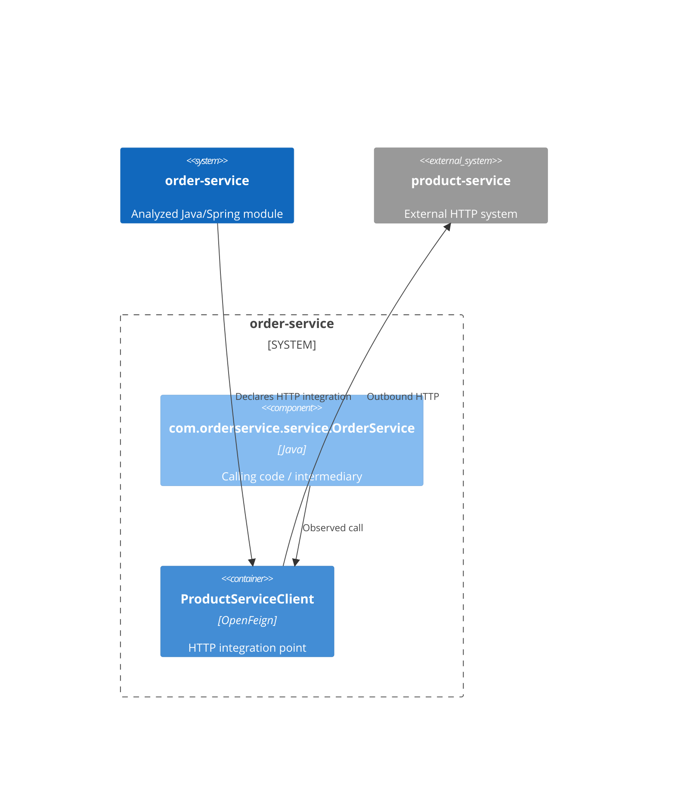

# Outbound HTTP dependencies: order-service

**Module:** order-service
**Module path:** /Users/edsnodgrass/Projects/build-a-software-factory/order-service

## Summary

Found 1 statically declared Feign outbound HTTP dependency.

An adapter is code that keeps the details of communicating with an external service separate from the module's own work. A domain-facing interface expresses what the calling code needs without exposing HTTP client details. The guidance below is a suggestion, not an observed fact or a required change.

## Finding 1: product-service

order-service makes an outbound HTTP connection to product-service through its ProductServiceClient Feign integration point.

- **External system:** product-service
- **Destination:** ${product-service.url} (destination unresolved)
- **Confidence:** Lower confidence. The client declaration is visible, but the destination contains an unresolved property placeholder. Its value was not guessed or resolved.
- **Client declaration evidence:** src/main/java/com/orderservice/client/ProductServiceClient.java:13

### HTTP operations (supporting detail)

- GET /products/{productId} (declared operation: getProduct). Evidence: src/main/java/com/orderservice/client/ProductServiceClient.java:16.

### How the code uses this connection

Source calls show possible behavior, not proof of execution. Observed usage describes source invocations only; destination confidence is separate from usage certainty.
The applied traversal limit is 2 call steps; the outbound HTTP connection and interface resolution do not count as steps.

- Chain 1 — Observed source chain: com.orderservice.service.OrderService → com.orderservice.client.ProductServiceClient. com.orderservice.service.OrderService calls the Feign integration point directly.

### Evidence and uncertainty

- Chain 1:
  - Observed call: Invocation in com.orderservice.service.OrderService.resolveItem at src/main/java/com/orderservice/service/OrderService.java:86; receiver productServiceClient declared as com.orderservice.client.ProductServiceClient at src/main/java/com/orderservice/service/OrderService.java:27; target method com.orderservice.client.ProductServiceClient.getProduct at src/main/java/com/orderservice/client/ProductServiceClient.java:16; method name at src/main/java/com/orderservice/client/ProductServiceClient.java:17.

### Where an adapter could fit

- **Suggestion:** Review whether com.orderservice.service.OrderService, which calls com.orderservice.client.ProductServiceClient directly, also handles business decisions. If so, a domain-facing interface between that calling code and the Feign integration could isolate external-service and HTTP details. The direct caller may itself serve as an adapter; direct use alone is not an architectural defect.

## Analysis coverage

127 call sites were not traced; external effects cannot be ruled out. Use `--show-analysis-limitations` for details.

## Architectural connections

## Limitations

ArchR analyzed Java source only within the targeted module's src/main/java; it did not compile, run, or modify the module. Test sources, generated source trees, and other modules are outside the analysis boundary. It did not resolve configuration or property placeholders.

The applied traversal limit is 2 call steps backward from each Feign client. The outbound HTTP connection and interface resolution do not consume call steps. Reaching the limit means a chain may continue, not that additional callers exist. Cycles stop traversal and are identified in the supporting evidence.

Supported usage forms are ordinary instance-method invocations through explicitly typed fields, including constructor-injected fields, written as field.method(...) or this.field.method(...). Types are resolved using packages, explicit imports, and fully qualified names. Methods are matched by name and argument count; indistinguishable overloads remain unresolved. Imports, field declarations, constructor assignments, and annotations alone are not usage.

Ordinary non-generic interfaces with one direct local concrete implementation can yield possible connections, not verified runtime wiring. Multiple implementations remain ambiguous; no local implementation does not establish that none exists elsewhere. Feign clients are terminal integration points.

Local-variable and parameter receivers, chained or dynamically constructed receivers, same-class helpers, inherited methods, generic method and interface resolution, method references, lambdas, and reflection are outside supported traversal. Relevant unresolved or unsupported connections remain beside findings with evidence. Coverage summarizes recorded untraced invocations; optional details list those sites, not a comprehensive inventory of unsupported syntax. Unsupported or unresolved connections are not proof of absence of callers.

Usage is source-only: runtime wiring and execution were not verified. Bean selection, qualifiers, profiles, factories, proxies, and runtime dispatch are not resolved. Source calls do not prove execution or reachability, and destination confidence is independent of usage certainty. ArchR does not determine whether a separate domain-facing port or adapter is needed or issue an architectural acceptance verdict. A Feign integration point is not assumed to be a sufficient architectural adapter.

Only supported Spring OpenFeign declarations and mapping annotations are reported. Other outbound HTTP mechanisms, messaging, databases, inherited operations, and runtime behavior are outside this analysis.
