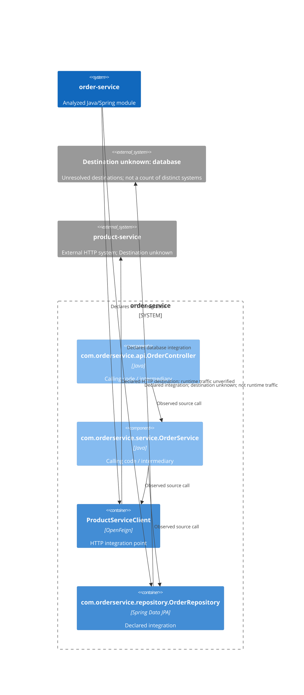

# Outbound dependencies: order-service

**Module:** order-service
**Module path:** /Users/edsnodgrass/Projects/build-a-software-factory/order-service

## Summary

Found 2 integration declarations: 1 HTTP and 1 database. These counts do not establish distinct external systems.
Found 1 statically declared Feign outbound HTTP dependency.

An adapter is code that keeps the details of communicating with an external service separate from the module's own work. A domain-facing interface expresses what the calling code needs without exposing HTTP client or persistence details. The guidance below is a suggestion, not an observed fact or a required change.

## Finding 1: product-service

order-service makes an outbound HTTP connection to product-service through its ProductServiceClient Feign integration point.

- **External system:** product-service
- **Destination:** ${product-service.url} (destination unresolved)
- **Confidence:** Lower confidence. The client declaration is visible, but the destination contains an unresolved property placeholder. Its value was not guessed or resolved.
- **Client declaration evidence:** src/main/java/com/orderservice/client/ProductServiceClient.java:13
- **Status:** Declared integration — Supported source operation caller found
This is a source declaration, not proof of execution. Destination confidence does not weaken declaration evidence or determine usage certainty.

### HTTP operations (supporting detail)

- GET /products/{productId} (declared operation: getProduct). Evidence: src/main/java/com/orderservice/client/ProductServiceClient.java:16.

### How the code uses this connection

Source calls show possible behavior, not proof of execution. Observed usage describes source invocations only; destination confidence is separate from usage certainty.
The applied traversal limit is 2 call steps; the external connection and interface resolution do not count as steps.

- Chain 1 — Observed source chain: com.orderservice.service.OrderService → com.orderservice.client.ProductServiceClient. com.orderservice.service.OrderService calls the Feign integration point directly.

### Evidence and uncertainty

- Chain 1:
  - Observed call: Invocation in com.orderservice.service.OrderService.resolveItem at src/main/java/com/orderservice/service/OrderService.java:86; receiver productServiceClient declared as com.orderservice.client.ProductServiceClient at src/main/java/com/orderservice/service/OrderService.java:27; target method com.orderservice.client.ProductServiceClient.getProduct at src/main/java/com/orderservice/client/ProductServiceClient.java:16; method name at src/main/java/com/orderservice/client/ProductServiceClient.java:17.

### Where an adapter could fit

- **Suggestion:** Review whether com.orderservice.service.OrderService, which calls com.orderservice.client.ProductServiceClient directly, also handles business decisions. If so, a domain-facing interface between that calling code and the Feign dependency could isolate external-service and HTTP details. The direct caller may itself serve as an adapter; direct use alone is not an architectural defect.

## Finding 2: com.orderservice.repository.OrderRepository

- **Mechanism:** Spring Data JPA — JPA persistence access through a directly declared repository interface.
- **Status:** Declared integration — Supported source operation caller found
- **Declaration evidence:** src/main/java/com/orderservice/repository/OrderRepository.java:9
- **Destination:** Destination unknown
Declaration evidence, destination certainty, and usage certainty are separate. A source invocation does not prove runtime execution.
No particular database, database name, or JDBC URL is established. A JPA repository does not establish direct JDBC calls; SQL is not inferred from repository method names.

### Operations and query evidence

- **Observed source operation call:** findByCustomerIdAndIdempotencyKey. Evidence: src/main/java/com/orderservice/service/OrderService.java:39.
- **Observed source operation call:** save. Evidence: src/main/java/com/orderservice/service/OrderService.java:47.
- **Observed source operation call:** findByReferenceAndCustomerId. Evidence: src/main/java/com/orderservice/service/OrderService.java:53.
- **Observed source operation call:** findByReference. Evidence: src/main/java/com/orderservice/service/OrderService.java:62.

### How the code uses this connection

Source calls show possible behavior, not proof of execution. Observed usage describes source invocations only; destination confidence is separate from usage certainty.
The applied traversal limit is 2 call steps; the external connection and interface resolution do not count as steps.

- Chain 1 — Observed source chain: com.orderservice.api.OrderController → com.orderservice.service.OrderService → com.orderservice.repository.OrderRepository. com.orderservice.service.OrderService calls the declared integration directly.
  com.orderservice.service.OrderService is an intermediary between the upstream calling code and this client; this describes the observed relationship, not a business responsibility inferred from its name.
- Chain 2 — Observed source chain: com.orderservice.api.OrderController → com.orderservice.service.OrderService → com.orderservice.repository.OrderRepository. com.orderservice.service.OrderService calls the declared integration directly.
  com.orderservice.service.OrderService is an intermediary between the upstream calling code and this client; this describes the observed relationship, not a business responsibility inferred from its name.
- Chain 3 — Observed source chain: com.orderservice.api.OrderController → com.orderservice.service.OrderService → com.orderservice.repository.OrderRepository. com.orderservice.service.OrderService calls the declared integration directly.
  com.orderservice.service.OrderService is an intermediary between the upstream calling code and this client; this describes the observed relationship, not a business responsibility inferred from its name.
- Chain 4 — Observed source chain: com.orderservice.api.OrderController → com.orderservice.service.OrderService → com.orderservice.repository.OrderRepository. com.orderservice.service.OrderService calls the declared integration directly.
  com.orderservice.service.OrderService is an intermediary between the upstream calling code and this client; this describes the observed relationship, not a business responsibility inferred from its name.

### Evidence and uncertainty

- Chain 1:
  - Observed call: Invocation in com.orderservice.api.OrderController.placeOrder at src/main/java/com/orderservice/api/OrderController.java:49; receiver orderService declared as com.orderservice.service.OrderService at src/main/java/com/orderservice/api/OrderController.java:34; target method com.orderservice.service.OrderService.placeOrder at src/main/java/com/orderservice/service/OrderService.java:37; method name at src/main/java/com/orderservice/service/OrderService.java:38.
  - Observed call: Invocation in com.orderservice.service.OrderService.placeOrder at src/main/java/com/orderservice/service/OrderService.java:39; receiver orderRepository declared as com.orderservice.repository.OrderRepository at src/main/java/com/orderservice/service/OrderService.java:26; recognized operation com.orderservice.repository.OrderRepository.findByCustomerIdAndIdempotencyKey. Integration declaration: src/main/java/com/orderservice/repository/OrderRepository.java:9. Library source and runtime execution were not inspected.
  - The 2-call-step boundary was reached; the chain may continue. This does not establish that more callers exist.
- Chain 2:
  - Observed call: Invocation in com.orderservice.api.OrderController.placeOrder at src/main/java/com/orderservice/api/OrderController.java:49; receiver orderService declared as com.orderservice.service.OrderService at src/main/java/com/orderservice/api/OrderController.java:34; target method com.orderservice.service.OrderService.placeOrder at src/main/java/com/orderservice/service/OrderService.java:37; method name at src/main/java/com/orderservice/service/OrderService.java:38.
  - Observed call: Invocation in com.orderservice.service.OrderService.placeOrder at src/main/java/com/orderservice/service/OrderService.java:47; receiver orderRepository declared as com.orderservice.repository.OrderRepository at src/main/java/com/orderservice/service/OrderService.java:26; recognized operation com.orderservice.repository.OrderRepository.save. Integration declaration: src/main/java/com/orderservice/repository/OrderRepository.java:9. Library source and runtime execution were not inspected.
  - The 2-call-step boundary was reached; the chain may continue. This does not establish that more callers exist.
- Chain 3:
  - Observed call: Invocation in com.orderservice.api.OrderController.getOrder at src/main/java/com/orderservice/api/OrderController.java:59; receiver orderService declared as com.orderservice.service.OrderService at src/main/java/com/orderservice/api/OrderController.java:34; target method com.orderservice.service.OrderService.getOrder at src/main/java/com/orderservice/service/OrderService.java:52; method name at src/main/java/com/orderservice/service/OrderService.java:52.
  - Observed call: Invocation in com.orderservice.service.OrderService.getOrder at src/main/java/com/orderservice/service/OrderService.java:53; receiver orderRepository declared as com.orderservice.repository.OrderRepository at src/main/java/com/orderservice/service/OrderService.java:26; recognized operation com.orderservice.repository.OrderRepository.findByReferenceAndCustomerId. Integration declaration: src/main/java/com/orderservice/repository/OrderRepository.java:9. Library source and runtime execution were not inspected.
  - The 2-call-step boundary was reached; the chain may continue. This does not establish that more callers exist.
- Chain 4:
  - Observed call: Invocation in com.orderservice.api.OrderController.advanceOrderStatus at src/main/java/com/orderservice/api/OrderController.java:69; receiver orderService declared as com.orderservice.service.OrderService at src/main/java/com/orderservice/api/OrderController.java:34; target method com.orderservice.service.OrderService.advanceStatus at src/main/java/com/orderservice/service/OrderService.java:56; method name at src/main/java/com/orderservice/service/OrderService.java:57.
  - Observed call: Invocation in com.orderservice.service.OrderService.advanceStatus at src/main/java/com/orderservice/service/OrderService.java:62; receiver orderRepository declared as com.orderservice.repository.OrderRepository at src/main/java/com/orderservice/service/OrderService.java:26; recognized operation com.orderservice.repository.OrderRepository.findByReference. Integration declaration: src/main/java/com/orderservice/repository/OrderRepository.java:9. Library source and runtime execution were not inspected.
  - The 2-call-step boundary was reached; the chain may continue. This does not establish that more callers exist.

### Where an adapter could fit

- **Suggestion:** com.orderservice.service.OrderService, between com.orderservice.api.OrderController and com.orderservice.repository.OrderRepository, is a candidate adapter location. Review whether its interface expresses the calling code's needs and keeps integration details out of calling code. Wrapping an integration alone does not establish adequate isolation.

## Analysis coverage

123 call sites were not traced; external effects cannot be ruled out. Use `--show-analysis-limitations` for details.

## Architectural connections

## Limitations

ArchR analyzed Java source only within the targeted module's src/main/java; it did not compile, run, or modify the module. Test sources, generated source trees, and other modules are outside the analysis boundary. It did not resolve configuration or property placeholders.

The applied traversal limit is 2 call steps backward from each recognized integration. The external connection and interface resolution do not consume call steps. Reaching the limit means a chain may continue, not that additional callers exist. Cycles stop traversal and are identified in the supporting evidence.

Supported usage forms are ordinary instance-method invocations through explicitly typed fields, including constructor-injected fields, written as field.method(...) or this.field.method(...). Types are resolved using packages, explicit imports, and fully qualified names. Methods are matched by name and argument count; indistinguishable overloads remain unresolved. Imports, field declarations, constructor assignments, and annotations alone are not usage.

Ordinary non-generic interfaces with one direct local concrete implementation can yield possible connections, not verified runtime wiring. Multiple implementations remain ambiguous; no local implementation does not establish that none exists elsewhere. Recognized library operations and Feign clients are terminal integration points; library source is not required.

Local-variable and parameter receivers, chained or dynamically constructed receivers, same-class helpers, inherited methods, generic method and interface resolution, method references, lambdas, and reflection are outside supported traversal, except for the specified repository operations and uninterrupted field-rooted WebClient expressions. Split fluent chains are not reconstructed. Relevant unresolved or unsupported connections remain beside findings with evidence. Coverage summarizes recorded untraced invocations; optional details list those sites, not a comprehensive inventory of unsupported syntax. Unsupported or unresolved connections are not proof of absence of callers.

Usage is source-only: runtime wiring and execution were not verified. Bean selection, qualifiers, profiles, factories, proxies, and runtime dispatch are not resolved. Source calls do not prove execution or reachability, and destination confidence is independent of usage certainty. ArchR does not determine whether a separate domain-facing port or adapter is needed or issue an architectural acceptance verdict. A Feign integration point is not assumed to be a sufficient architectural adapter.

Recognized declarations are Spring OpenFeign interfaces, interfaces directly extending Spring Data JpaRepository, and explicitly typed JdbcTemplate, RestTemplate, and WebClient fields, including constructor-injected fields. These Spring types require explicit import, package, or fully qualified type evidence; matching simple names and imports alone are insufficient. Parameters alone, locals, and bean factory methods do not create declarations. Repositories expose declared methods and the bounded common inherited persistence operations, not generated SQL. JdbcTemplate supports query, queryForObject, queryForList, update, execute, and batchUpdate. RestTemplate supports the specified verb-specific operations and exchange; HTTP method and destination evidence may remain unresolved independently. WebClient supports uninterrupted field-rooted verb/uri expressions with retrieve, exchangeToMono, or exchangeToFlux request operations; builder-only expressions are not request callers. Recognized fluent segments count as one call step, not separate untraced receiver sites; nested argument calls remain separate. Query expressions and destination uncertainty stay beside their integration findings, rather than becoming untraced call sites. Other HTTP and database libraries, indirect repository inheritance, custom client subclasses, configuration resolution, and runtime behavior are outside this analysis.
