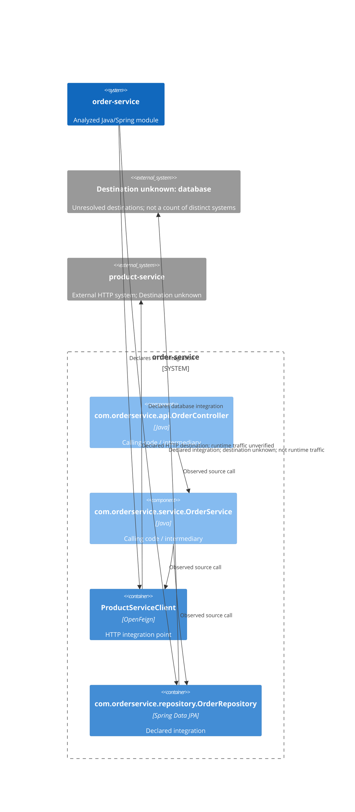

# Outbound dependencies: order-service

**Module:** order-service
**Module path:** /Users/edsnodgrass/Projects/build-a-software-factory/order-service

## Summary

Found 2 integration declarations: 1 HTTP and 1 database. These counts do not establish distinct external systems.
Found 1 statically declared Feign outbound HTTP dependency.

## Architectural Connections



## Findings

### Finding 1: ProductServiceClient

- **Destination:** ${product-service.url} (destination unresolved)
- **Status:** Caller found
- **External system:** product-service
- **Mechanism:** OpenFeign HTTP client
- **Adapter Recommendation:** Inspect com.orderservice.service.OrderService.resolveItem to determine whether it handles integration-specific failures or mixes integration details with module decisions. [Review guidance](#finding-1-guidance)
[Evidence](#finding-1-evidence)


### Finding 2: com.orderservice.repository.OrderRepository

- **Destination:** Unknown
- **Status:** Caller found
- **External system:** Unknown
- **Mechanism:** Spring Data JPA
- **Adapter Recommendation:** Inspect com.orderservice.service.OrderService.placeOrder to determine whether it handles integration-specific failures or mixes integration details with module decisions. [Review guidance](#finding-2-guidance)
[Evidence](#finding-2-evidence)


## Adapter Review Guidance

An adapter is code that keeps the details of communicating with an external service separate from the module's own work. The guidance below identifies conditions to inspect, not observed behavior, a required change, or a proposed implementation.
<a id="finding-1-guidance"></a>

### Finding 1: ProductServiceClient


#### Review conditions


#### Review com.orderservice.service.OrderService.resolveItem

Inspect com.orderservice.service.OrderService.resolveItem, the observed direct caller of com.orderservice.client.ProductServiceClient.getProduct, for the following conditions; ArchR has not established that any of them occurs.

**Interpreting a client response**

Check whether this method translates external fields, statuses, or representations into meaning used by this module.

Illustrative only — if your code looks like this in com.orderservice.service.OrderService.resolveItem: ArchR did not establish this behavior. These Java statements use hypothetical local values, not a reconstruction of source.

```java
boolean available = externalStatus.equals("AVAILABLE");
```

**Handling integration-specific failures**

Check whether this method directly reacts to HTTP status codes, timeouts, client-library exceptions, or retry rules.

Illustrative only — if your code looks like this in com.orderservice.service.OrderService.resolveItem: ArchR did not establish this behavior. These Java statements use hypothetical local values, not a reconstruction of source.

```java
if (httpStatus == 503) {
    retry = true;
}
```

**Mixing integration details with business decisions**

Check whether the same method both communicates with the dependency and decides what the module should do.

Illustrative only — if your code looks like this in com.orderservice.service.OrderService.resolveItem: ArchR did not establish this behavior. These Java statements use hypothetical local values, not a reconstruction of source.

```java
// After the client call in this method:
if (externalQuantity > requestedQuantity) {
    orderAccepted = true;
}
```
<a id="finding-2-guidance"></a>

### Finding 2: com.orderservice.repository.OrderRepository


#### Review conditions


#### Review com.orderservice.service.OrderService.placeOrder

Inspect com.orderservice.service.OrderService.placeOrder, the observed direct caller of com.orderservice.repository.OrderRepository.findByCustomerIdAndIdempotencyKey, for the following conditions; ArchR has not established that any of them occurs.

**Interpreting persistence results**

Check whether this method translates stored fields or query results into meaning used by this module.

Illustrative only — if your code looks like this in com.orderservice.service.OrderService.placeOrder: ArchR did not establish this behavior. These Java statements use hypothetical local values, not a reconstruction of source.

```java
boolean eligible = storedStatus.equals("ACTIVE");
```

**Handling integration-specific failures**

Check whether this method directly reacts to SQL errors, persistence-library exceptions, or persistence retry rules.

Illustrative only — if your code looks like this in com.orderservice.service.OrderService.placeOrder: ArchR did not establish this behavior. These Java statements use hypothetical local values, not a reconstruction of source.

```java
if (sqlState.equals("40001")) {
    retry = true;
}
```

**Mixing integration details with business decisions**

Check whether the same method both communicates with the database and decides what the module should do.

Illustrative only — if your code looks like this in com.orderservice.service.OrderService.placeOrder: ArchR did not establish this behavior. These Java statements use hypothetical local values, not a reconstruction of source.

```java
// After the persistence call in this method:
if (storedQuantity > requestedQuantity) {
    orderAccepted = true;
}
```

#### Review com.orderservice.service.OrderService.getOrder

Inspect com.orderservice.service.OrderService.getOrder, the observed direct caller of com.orderservice.repository.OrderRepository.findByReferenceAndCustomerId, for the following conditions; ArchR has not established that any of them occurs.

**Interpreting persistence results**

Check whether this method translates stored fields or query results into meaning used by this module.

Illustrative only — if your code looks like this in com.orderservice.service.OrderService.getOrder: ArchR did not establish this behavior. These Java statements use hypothetical local values, not a reconstruction of source.

```java
boolean eligible = storedStatus.equals("ACTIVE");
```

**Handling integration-specific failures**

Check whether this method directly reacts to SQL errors, persistence-library exceptions, or persistence retry rules.

Illustrative only — if your code looks like this in com.orderservice.service.OrderService.getOrder: ArchR did not establish this behavior. These Java statements use hypothetical local values, not a reconstruction of source.

```java
if (sqlState.equals("40001")) {
    retry = true;
}
```

**Mixing integration details with business decisions**

Check whether the same method both communicates with the database and decides what the module should do.

Illustrative only — if your code looks like this in com.orderservice.service.OrderService.getOrder: ArchR did not establish this behavior. These Java statements use hypothetical local values, not a reconstruction of source.

```java
// After the persistence call in this method:
if (storedQuantity > requestedQuantity) {
    orderAccepted = true;
}
```

#### Review com.orderservice.service.OrderService.advanceStatus

Inspect com.orderservice.service.OrderService.advanceStatus, the observed direct caller of com.orderservice.repository.OrderRepository.findByReference, for the following conditions; ArchR has not established that any of them occurs.

**Interpreting persistence results**

Check whether this method translates stored fields or query results into meaning used by this module.

Illustrative only — if your code looks like this in com.orderservice.service.OrderService.advanceStatus: ArchR did not establish this behavior. These Java statements use hypothetical local values, not a reconstruction of source.

```java
boolean eligible = storedStatus.equals("ACTIVE");
```

**Handling integration-specific failures**

Check whether this method directly reacts to SQL errors, persistence-library exceptions, or persistence retry rules.

Illustrative only — if your code looks like this in com.orderservice.service.OrderService.advanceStatus: ArchR did not establish this behavior. These Java statements use hypothetical local values, not a reconstruction of source.

```java
if (sqlState.equals("40001")) {
    retry = true;
}
```

**Mixing integration details with business decisions**

Check whether the same method both communicates with the database and decides what the module should do.

Illustrative only — if your code looks like this in com.orderservice.service.OrderService.advanceStatus: ArchR did not establish this behavior. These Java statements use hypothetical local values, not a reconstruction of source.

```java
// After the persistence call in this method:
if (storedQuantity > requestedQuantity) {
    orderAccepted = true;
}
```

## Findings with Evidence
<a id="finding-1-evidence"></a>

### Finding 1: ProductServiceClient

#### Declaration

Client declaration evidence: src/main/java/com/orderservice/client/ProductServiceClient.java:13
Destination confidence: Lower confidence. The client declaration is visible, but the destination contains an unresolved property placeholder. Its value was not guessed or resolved.

#### Operations

- GET /products/{productId} (declared operation: getProduct). Evidence: src/main/java/com/orderservice/client/ProductServiceClient.java:16.

#### Observed Call Chains

- Observed source chain: com.orderservice.service.OrderService.resolveItem → com.orderservice.client.ProductServiceClient.getProduct.
<a id="finding-2-evidence"></a>

### Finding 2: com.orderservice.repository.OrderRepository

#### Declaration

Declaration evidence: src/main/java/com/orderservice/repository/OrderRepository.java:9

#### Operations

No particular database, database name, or JDBC URL is established. A JPA repository does not establish direct JDBC calls; SQL is not inferred from repository method names.
- **Observed source operation call:** findByCustomerIdAndIdempotencyKey. Evidence: src/main/java/com/orderservice/service/OrderService.java:39.
- **Observed source operation call:** save. Evidence: src/main/java/com/orderservice/service/OrderService.java:47.
- **Observed source operation call:** findByReferenceAndCustomerId. Evidence: src/main/java/com/orderservice/service/OrderService.java:53.
- **Observed source operation call:** findByReference. Evidence: src/main/java/com/orderservice/service/OrderService.java:62.

#### Observed Call Chains

- Observed source chain: com.orderservice.api.OrderController.placeOrder → com.orderservice.service.OrderService.placeOrder
  - → com.orderservice.repository.OrderRepository.findByCustomerIdAndIdempotencyKey
  - → com.orderservice.repository.OrderRepository.save
  - The 2-call-step boundary was reached; the chain may continue. This does not establish that more callers exist.
- Observed source chain: com.orderservice.api.OrderController.getOrder → com.orderservice.service.OrderService.getOrder → com.orderservice.repository.OrderRepository.findByReferenceAndCustomerId.
  - The 2-call-step boundary was reached; the chain may continue. This does not establish that more callers exist.
- Observed source chain: com.orderservice.api.OrderController.advanceOrderStatus → com.orderservice.service.OrderService.advanceStatus → com.orderservice.repository.OrderRepository.findByReference.
  - The 2-call-step boundary was reached; the chain may continue. This does not establish that more callers exist.

## Limitations

ArchR analyzed Java source only within the targeted module's src/main/java; it did not compile, run, or modify the module. Other source trees and modules are outside this boundary. Declarations and source calls do not prove runtime wiring, execution, or reachability. Destination confidence is independent of caller certainty.

The applied traversal limit is 2 call steps backward from each integration; interface resolution and the external connection do not consume steps. Library source is not required for terminal operations.

**Caller found** means a supported source caller chain was established. **No caller found** means no supported caller or relevant unresolved caller was recorded within this boundary. **Caller unresolved** means evidence connects a possible caller to the integration, but analysis cannot resolve that connection. Unsupported or unresolved connections are not proof of absence of callers.

Supported mechanisms are OpenFeign, direct Spring Data JpaRepository interfaces, and typed JdbcTemplate, RestTemplate, and WebClient fields. Supported calls use explicitly typed fields (including constructor-injected fields): field.method(...) or this.field.method(...), plus bounded repository operations and uninterrupted field-rooted WebClient requests. Local interface connections may be possible rather than certain. Other HTTP and database mechanisms are outside scope.

Configuration and property placeholders are not resolved; unknown or unresolved destinations retain their source uncertainty in the evidence. Finding-specific query, interface, and path uncertainty is recorded there, not repeated here. Coverage counts recorded untraced calls, not every unsupported Java construct.


### Analysis coverage

123 call sites were not traced; external effects cannot be ruled out. Use `--show-analysis-limitations` for details.
