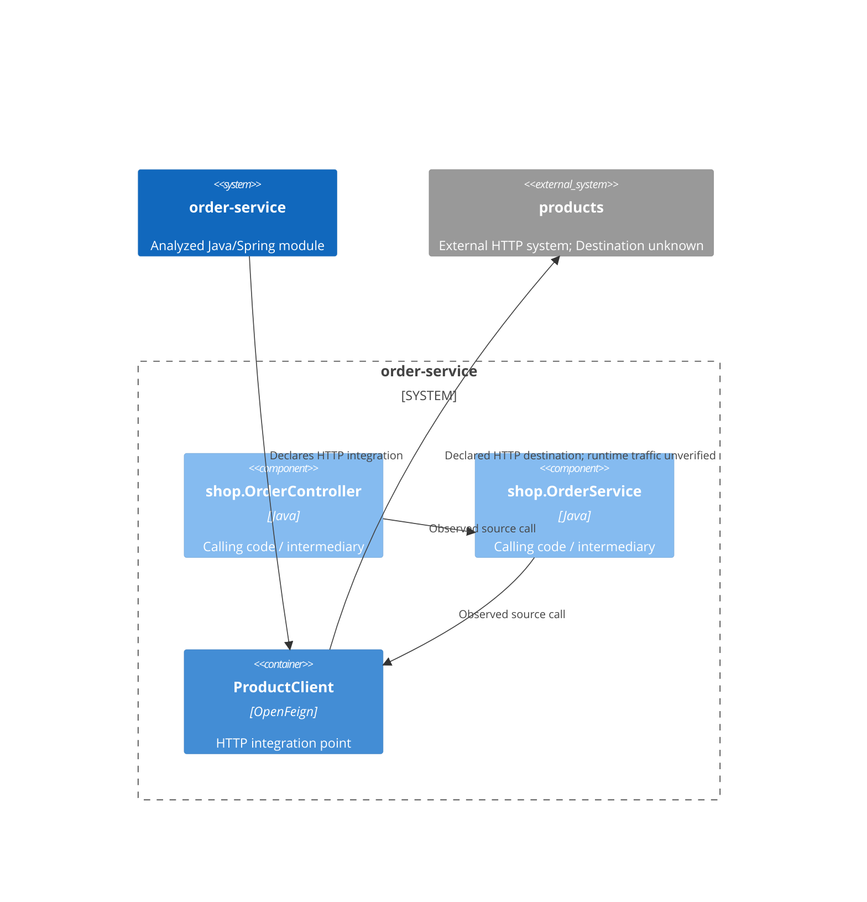

# Outbound dependencies: order-service

**Module:** order-service
**Module path:** tests/fixtures/feign-failure/order-service

## Summary

Found 1 integration declarations: 1 HTTP and 0 database. These counts do not establish distinct external systems.
Found 1 statically declared Feign outbound HTTP dependency.

## Architectural Connections



## Findings

### Finding 1: ProductClient

- **Destination:** ${products.url} (destination unresolved)
- **Status:** Caller found
- **External system:** products
- **Mechanism:** OpenFeign HTTP client
- **Adapter Recommendation:** Inspect shop.OrderService.placeOrder to determine whether it handles integration-specific failures or mixes integration details with module decisions. [Review guidance](#finding-1-guidance)
[Evidence](#finding-1-evidence)


## Adapter Review Guidance

An adapter is code that keeps the details of communicating with an external service separate from the module's own work. The guidance below distinguishes observed source structure, where reported, from conditions to inspect. It does not establish a required change or prescribe an implementation.
<a id="finding-1-guidance"></a>

### Finding 1: ProductClient


#### Review conditions


#### Review shop.OrderService.placeOrder

Inspect shop.OrderService.placeOrder, the observed direct caller of shop.ProductClient.getProduct. ArchR observed the Feign-specific catch structure described below; the remaining review conditions are conditional, not established behavior.

**Interpreting a client response**

Check whether this method translates external fields, statuses, or representations into meaning used by this module.

Illustrative only — if your code looks like this in shop.OrderService.placeOrder: ArchR did not establish this behavior. These Java statements use hypothetical local values, not a reconstruction of source.

```java
boolean available = externalStatus.equals("AVAILABLE");
```

**Handling integration-specific failures**

shop.OrderService.placeOrder calls shop.ProductClient.getProduct inside a try with a feign.FeignException catch. Call: src/main/java/shop/OrderService.java:14; catch: src/main/java/shop/OrderService.java:15.
This method names a client-library exception. Consider whether it is the right boundary for Feign-specific failures. An adapter could catch the exception at the integration boundary and expose an application-level failure, leaving application code to decide how to respond without depending on Feign exception types. The application contract determines the appropriate outcome; this catch alone does not establish what that outcome should be. This caller may already serve as that adapter. Review its responsibilities before adding another layer; another wrapper may add no value. The observed structure does not prove that the call throws or that the handler executes.

**Mixing integration details with business decisions**

Check whether the same method both communicates with the dependency and decides what the module should do.

Illustrative only — if your code looks like this in shop.OrderService.placeOrder: ArchR did not establish this behavior. These Java statements use hypothetical local values, not a reconstruction of source.

```java
// After the client call in this method:
if (externalQuantity > requestedQuantity) {
    orderAccepted = true;
}
```

## Findings with Evidence
<a id="finding-1-evidence"></a>

### Finding 1: ProductClient

#### Declaration

Client declaration evidence: src/main/java/shop/ProductClient.java:6
Destination confidence: Lower confidence. The client declaration is visible, but the destination contains an unresolved property placeholder. Its value was not guessed or resolved.

#### Operations

- GET /products/{id} (declared operation: getProduct). Evidence: src/main/java/shop/ProductClient.java:8.

#### Observed Call Chains

- Observed source chain: shop.OrderController.place → shop.OrderService.placeOrder → shop.ProductClient.getProduct.
  - The 2-call-step boundary was reached; the chain may continue. This does not establish that more callers exist.

## Limitations

ArchR analyzed Java source only within the targeted module's src/main/java; it did not compile, run, or modify the module. Other source trees and modules are outside this boundary. Declarations and source calls do not prove runtime wiring, execution, or reachability. Destination confidence is independent of caller certainty.

The applied traversal limit is 2 call steps backward from each integration; interface resolution and the external connection do not consume steps. Library source is not required for terminal operations.

**Caller found** means a supported source caller chain was established. **No caller found** means no supported caller or relevant unresolved caller was recorded within this boundary. **Caller unresolved** means evidence connects a possible caller to the integration, but analysis cannot resolve that connection. Unsupported or unresolved connections are not proof of absence of callers.

Supported mechanisms are OpenFeign, direct Spring Data JpaRepository interfaces, and typed JdbcTemplate, RestTemplate, and WebClient fields. Supported calls use explicitly typed fields (including constructor-injected fields): field.method(...) or this.field.method(...), plus bounded repository operations and uninterrupted field-rooted WebClient requests. Local interface connections may be possible rather than certain. Other HTTP and database mechanisms are outside scope.

Configuration and property placeholders are not resolved; unknown or unresolved destinations retain their source uncertainty in the evidence. Finding-specific query, interface, and path uncertainty is recorded there, not repeated here. Coverage counts recorded untraced calls, not every unsupported Java construct.


### Analysis coverage

No untraced call sites recorded within supported analysis.
